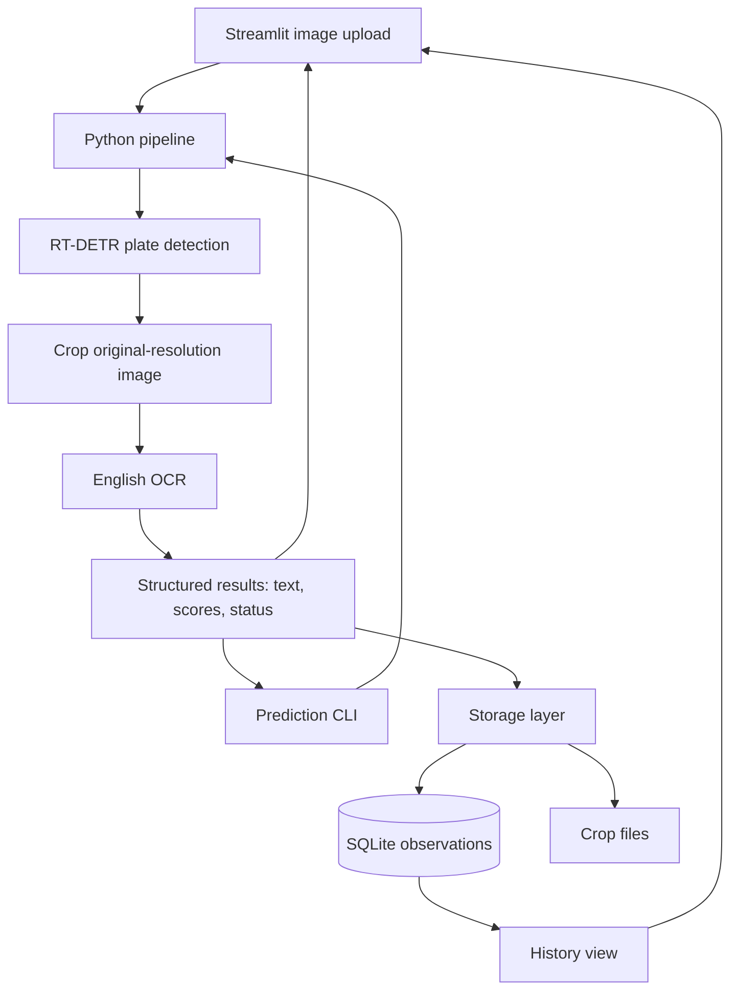

# Proposed MVP architecture

Status: planned architecture; the current MVP files are scaffolding.

The detector returns boxes in original-image coordinates. The pipeline validates
and clamps coordinates before cropping. Visualization draws on a separate copy.
Load models once and reuse them across images.

Results should preserve raw and normalized OCR text, separate detection and OCR
scores, bounding boxes, status, source ID, timing, and model versions. Scores are
model outputs, not calibrated probabilities of a correct plate reading.

Storage saves observation metadata in SQLite and crop references on disk. UI
reruns must not automatically create duplicate observations. Later API or video
entry points can reuse the pipeline; tracking and event logic remain future work.
