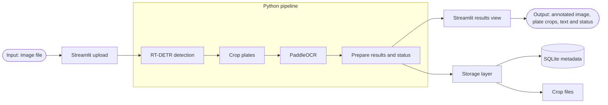

# Proposed MVP architecture

Status: planned architecture; the current MVP files are scaffolding.

1. The image file enters through Streamlit upload. 
2. The Python pipeline groups the detection, cropping, OCR, and result-preparation components. It returns structured data to the results view, which presents the annotated image, plate crops, text, and status to the user. 
3. Storage branches from the structured results.

The detector returns boxes in original-image coordinates. The pipeline validates
and clamps coordinates before cropping. Visualization draws on a separate copy.
Load models once and reuse them across images.

Results should preserve raw and normalized OCR text, separate detection and OCR
scores, bounding boxes, status, source ID, timing, and model versions. Scores are
model outputs, not calibrated probabilities of a correct plate reading.

Storage saves observation metadata in SQLite and crop references on disk. UI
reruns must not automatically create duplicate observations. The prediction CLI
can call the same pipeline; it is omitted from this diagram to keep the primary
user journey clear. Later API or video entry points can also reuse the pipeline;
tracking and event logic remain future work.

## Configuration boundary — agreed 2026-11-10

The app or prediction CLI loads YAML once and passes relevant settings to the
detector, OCR, pipeline/cropping, and storage components. Those components do not
read the YAML themselves.

Configuration owns required fields, types, supported values, numeric ranges and
path resolution against the project root. It returns structured settings or a
clear configuration error, without initializing/downloading models, creating
output directories, or opening the database.

Each component validates the resources it needs when initializing. A missing OCR
model therefore does not prevent detector-only work. Resolving a path does not
establish that the resource exists or can load.

Frozen dataclasses for component settings and the grouped AppConfig were agreed
on 2026-11-10. The user's field/signature skeleton was reviewed against the
supplied contract; decorator spelling and missing class docstrings were corrected.
The corrected skeleton imports successfully, but internal implementation has not
begun. Configuration tests will be rewritten after implementation, as requested
by the user; the current test file is empty.
