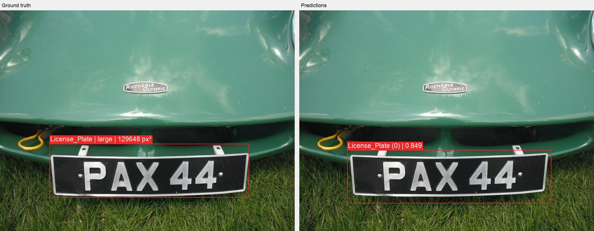
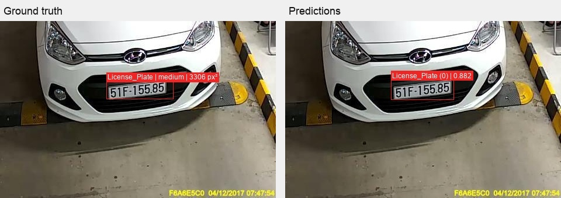
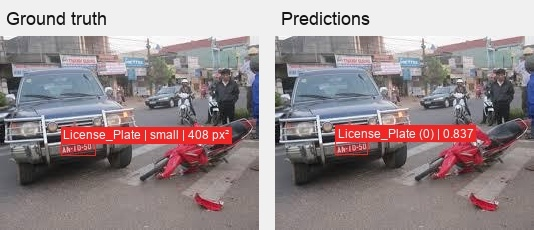
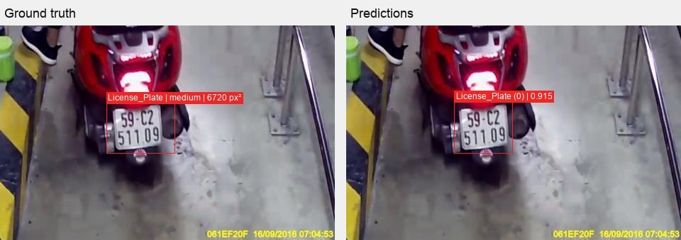

# Selected qualitative comparisons

These four examples accompany the [baseline report](../../report.md) and [visual review notes](../../../../../runs/baseline-001/eval-epoch19/visual-checks/review.md). They were selected from the existing validation comparisons, not randomly sampled. They do not establish annotation-error prevalence or model failure rates.

Ground truth is on the left; checkpoint 19 EMA predictions are on the right. Ground-truth tags use annotation area in original-image pixels squared. Prediction overlays display scores strictly above 0.6; this visualization cutoff was not applied to AP evaluation. Each panel preserves the source image dimensions; a header and gutter were added.

## Source and attribution

Images and annotations: **License Plate Recognition, version 13**, provided by **Roboflow Universe Projects**. [Dataset source](https://universe.roboflow.com/roboflow-universe-projects/license-plate-recognition-rxg4e/dataset/13) · [CC BY 4.0 license](https://creativecommons.org/licenses/by/4.0/).

The source dataset page and exported annotation metadata identify CC BY 4.0. This attribution applies to the bundled evaluation annotations and the four derived comparison images; it does not relicense the repository's code or other materials.

Modifications: the evaluated Kaggle annotation file historically converted category IDs from 1 to 0, retaining duplicate category metadata with ID 0. This package preserves that evaluated file unchanged. Visualizations add ground-truth boxes, size labels, model predictions, scores, and side-by-side layout, and were saved as JPEGs. These four existing outputs were copied byte-for-byte for this evidence package. No endorsement by the dataset provider is implied.

The bundled annotation file is [kaggle_val_annotations.json](../../../../../data/raw/annotations/kaggle_val_annotations.json). The checkpoint and complete validation-image and visualization collections remain local-only. Artifact hashes and availability are listed in the [manifest](../../artifact-manifest.json).

## Large plate: loose ground truth

The reviewed ground-truth box is excessively loose. Compare both boxes against the visible plate; disagreement with this annotation does not automatically indicate a model error.

## Car scene relevant to the application

This image was judged to have comparatively good annotation quality and to resemble the intended parking-entry use case.

## Small-plate example

The reviewed annotation appeared acceptable. This example illustrates inspection at small object sizes; it does not measure the prevalence of localization errors.

## Motorcycle plates and application relevance

Reviewed xemay images raised annotation-quality concerns and contain motorcycle plates. Motorcycle plates remain valid license-plate instances; their relevance to a car-parking application is a separate question.
