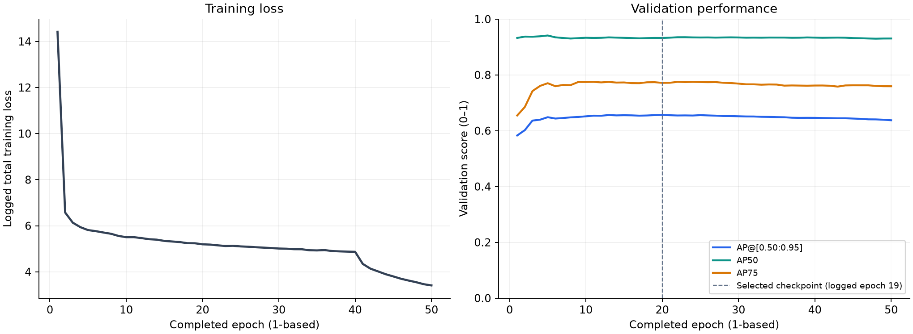

# Baseline-001: RT-DETRv2 License-Plate Detection

Alexander Aung Khant Bwar · October 27, 2026 · Training run: September 26, 2026

## Overview

This experiment establishes a license-plate detection baseline for a planned AI parking monitoring system. An RT-DETRv2 detector with a ResNet-18 backbone was fine-tuned on **10,000 training images**, evaluated on **2,048 validation images**, and trained for 50 epochs on **one NVIDIA T4 GPU** in Kaggle.

The best checkpoint reached **validation AP@[0.50:0.95] of 0.6565**, with AP50 of 0.9323. Independent test performance, live-video speed, and OCR quality have not been measured. The current experiment takes still images and returns plate bounding boxes and confidence scores; plate reading and parking operations remain future components.

The question was practical: what performance could this configuration establish within the available GPU resources, and what should the next experiment investigate? No accuracy or speed target was predefined. The baseline provides a reference for subsequent comparisons.

**Navigate:** [Results](#results-and-interpretation) · [Approach](#approach-and-key-decisions) · [Limitations](#limitations-and-next-experiment) · [Technical appendix](technical-appendix.md)

## Results and interpretation

The selected checkpoint is from **epoch 20**. The log and checkpoint filename use zero-based index 19. Selection used the highest validation AP@[0.50:0.95] across the run.

All scores below use a **0–1 scale**. Average precision (AP) summarizes the precision–recall curve. Intersection over union (IoU) measures the overlap between a predicted box and its ground-truth box. AP50 and AP75 use overlap thresholds of 0.50 and 0.75; the primary metric averages AP over thresholds from 0.50 to 0.95.

| Validation metric | Best checkpoint |
|---|---:|
| AP@[0.50:0.95] | **0.6565** |
| AP50 | 0.9323 |
| AP75 | 0.7714 |
| AP small | 0.4189 |
| AP medium | 0.7143 |
| AP large | 0.6686 |

Source: [extracted metrics](metrics.json), backed by the [epoch log](log.txt). Small, medium, and large follow COCO's pixel-area categories, which differ from the relative-area thresholds used during training-data selection.



*Training loss and validation metrics across 50 completed epochs. The selected checkpoint occurs at epoch 20; the final checkpoint has lower primary AP. Validation loss was not recorded.*

Three observations guide the next investigation:

- **Small plates are the weakest evaluated size group.** AP small is 0.4189, compared with 0.7143 for medium plates. Reviewing small-plate predictions can help distinguish missed detections, confidence issues, and box-alignment errors.
- **Scores decrease under stricter overlap requirements.** AP75 is lower than AP50. Inspecting predicted boxes is necessary to understand the gap; the aggregate scores alone do not identify the cause.
- **More epochs did not improve the best result.** Final AP is 0.6374, approximately 0.0190 below the peak, while training loss continues to decrease overall. This supports retaining the earlier checkpoint, but does not by itself prove overfitting.

These results identify useful questions. Prediction-level error analysis is still pending, so explanations involving blur, lighting, occlusion, or camera angle remain untested.

## Approach and key decisions

```text
Audit data → Filter and sample → Fine-tune detector → Evaluate on validation split
```

The project-specific workflow covers data auditing and selection, a license-plate training configuration, and baseline evaluation. The detector architecture and training framework come from the [upstream RT-DETR implementation](https://github.com/lyuwenyu/RT-DETR). This experiment adapts that implementation to a single-class detection task.

### Prepare a bounded training subset

The source is [Roboflow License Plate Recognition v13](https://universe.roboflow.com/roboflow-universe-projects/license-plate-recognition-rxg4e/dataset/13), exported in COCO format. The original training split contains 98,798 images. The audit checks decoding, dimensions, image/annotation pairing, basic box validity, relative box sizes, and byte-identical duplicates without modifying raw data.

The audit recorded zero error-level findings and 2,278 warnings. Warnings flag cases for review; they do not establish that labels are incorrect. Sample inspection found very small and very large plates, but no manual annotation corrections were made.

Selection removed unannotated and multiple-box images, then retained boxes between the single-box population's 5th and 95th relative-area percentiles. This left **86,085 candidate images**. Proportional sampling across five equal-width relative-area bins produced the 10,000-image baseline, using sampling seed 42.

This creates a bounded starting dataset, but reduces coverage of multiple-plate scenes and extreme plate sizes relevant to CCTV. The original validation split remained intact. Source training images already included augmentations; those are separate from the transformations applied during fine-tuning.

### Fit the available hardware

RT-DETRv2's real-time detection focus motivated its selection for the planned CCTV pipeline. Actual inference speed still needs measurement. A larger configuration encountered a CUDA out-of-memory error, after which the backbone was changed to ResNet-18. The failed configuration was not fully recorded, so this establishes feasibility for the completed setup without ruling out other larger-model configurations.

The completed run used 640 × 640 inputs, training batch size 8, and AdamW for 50 epochs. It fine-tuned from a COCO checkpoint and enabled an exponential moving average (EMA) of model weights. Training included appearance and geometric augmentations; validation used deterministic resizing and scaling. Full settings and resume history are in the [technical appendix](technical-appendix.md#training-configuration-and-run-history).

## Limitations and next experiment

The main limits on interpreting this baseline are:

- **Data independence and coverage:** cross-split duplicate/source relationships remain unchecked, label correctness is unquantified, and filtering excludes some relevant CCTV conditions.
- **Evaluation scope:** validation selected the checkpoint. There is no independent test result, reviewed prediction set, representative CCTV benchmark, OCR assessment, or measured detector latency/FPS.
- **Reproduction and variability:** the historical training revision, full environment, and uploaded annotation conversion are incomplete. Training randomness was not explicitly seeded; sampling seed 42 applies only to dataset selection. There are no repeated runs or uncertainty estimates.

The following work is proposed, not completed:

1. **Resolve data questions.** Preserve the actual Kaggle annotations and historical code, verify class mapping, and check cross-split duplicates and source relationships. Local annotations use plate category ID 1 with an unused ID 0 entry, while the configuration specifies one model class.
2. **Review model mistakes.** Inspect validation predictions, prioritizing small plates, and record examples of misses, false positives, and poorly aligned boxes. Separate model failures from possible annotation issues.
3. **Run one controlled comparison.** Use the reviewed errors to select one training change, record its hypothesis beforehand, and keep the comparison protocol fixed. The evidence does not yet justify choosing a specific intervention.
4. **Assess intended use.** Evaluate the frozen selected model on a verified independent test split and representative CCTV frames. Measure detector latency separately from OCR and video handling.

## Evidence and reproduction

The [training notebook](../../../notebooks/baseline-training.ipynb), [metrics](metrics.json), and [configuration snapshot](resolved-training-config.json) support inspection of the completed run. The [error-analysis document](error_analysis.md) records the current status of prediction review.

Exact reproduction still requires resolving the missing historical details and updating environment-specific paths and configuration includes. The snapshot is a record of the run, not a ready-to-run local configuration.

The [technical appendix](technical-appendix.md) contains the full audit, model and training settings, evaluation protocol, best/final metrics, historical Kaggle commands, and artifact inventory. Relative artifact links refer to the local workspace; their presence does not guarantee availability in the public repository. The [Kaggle notebook reference](https://www.kaggle.com/code/aungkhantbwar/rt-detr-baseline-training) provides an external entry point.
