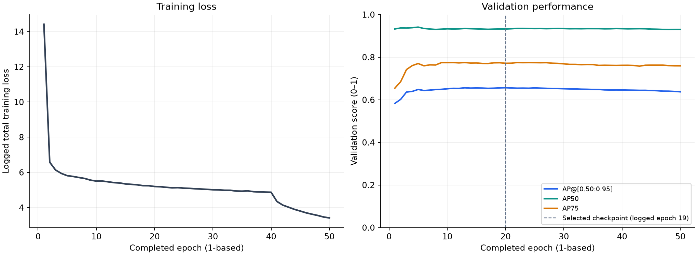

# Baseline-001: RT-DETRv2 License-Plate Detection

Alexander Aung Khant Bwar · Updated October 31, 2026 · Training run: September 26, 2026

## Overview

**This baseline experiment** establishes a license-plate detection baseline for a planned AI parking monitoring system. An RT-DETRv2 detector with a ResNet-18 backbone was fine-tuned on **10,000 training images**, evaluated on **2,048 validation images**, and trained for 50 epochs on **one NVIDIA T4 GPU** in Kaggle.

**The best checkpoint reached validation AP@[0.50:0.95] of 0.6565**, with AP50 of 0.9323. Independent test performance. The current experiment takes still images and returns plate bounding boxes and confidence scores.

**The question was practical:** what performance could this baseline configuration establish within the available GPU resources, and what should the next experiment investigate? No accuracy or speed target was predefined. The baseline provides a reference for subsequent comparisons.

**Navigate:** [Results](#results-and-interpretation) · [Local re-evaluation](#local-re-evaluation-and-class-mapping) · [Visual findings](#findings-from-visual-inspection) · [Approach](#approach-and-key-decisions) · [Limitations](#limitations-and-next-experiment) · [Evidence](#evidence-and-reproduction) · [Technical appendix](technical-appendix.md)

## Results and interpretation

The selected checkpoint is from **epoch 20**. The log and checkpoint filename use zero-based index 19. Selection used the highest validation AP@[0.50:0.95] across the run.

| Metric | Overall | Small | Medium | Large |
|---|---:|---:|---:|---:|
| AP50 | 0.9323 | 0.7363 | 0.9802 | 0.9487 |
| AP75 | 0.7714 | 0.4311 | 0.8620 | 0.7577 |
| AP50:95 | 0.6565 | 0.4189 | 0.7143 | 0.6686 |

Overall AP and size-specific AP@[0.50:0.95] are supported by the [epoch log](log.txt) and reproduced [local evaluation metrics](../../../runs/baseline-001/eval-epoch19/metrics.md). Size-specific AP50 and AP75 were extracted from the local [COCO evaluation output](../../../runs/baseline-001/eval-epoch19/eval.pth). Small, medium, and large follow the [recorded COCO annotation-area ranges](../../../runs/baseline-001/eval-epoch19/evaluation-config.md) in original-image pixels, which differ from the relative-area thresholds used during training-data selection.

## Local re-evaluation and class mapping

Checkpoint [checkpoint0019.pth](../../../runs/baseline-001/checkpoints/checkpoint0019.pth) was re-evaluated locally on CPU using its EMA weights, the configured 640 × 640 validation preprocessing, and 2,048 validation images containing 2,195 annotated boxes. The resulting overall AP and size-specific AP@[0.50:0.95] matched the training log at the reported precision. Local AR@100, averaged over IoU thresholds 0.50–0.95, was **0.736** at the evaluator’s displayed precision.

Size-specific AP50 and AP75 were extracted from the saved COCO precision array using a maximum of 100 detections per image, excluding unavailable entries before averaging.

The first local evaluation produced zero AP and recall because the model predicted category `0`, while the [original local annotations](../../../data/raw/annotations/valid_annotations.json) used category `1`. Comparing the actual [Kaggle validation annotations](../../../data/raw/annotations/kaggle_val_annotations.json) with the original file confirmed that category IDs had been converted to `0`; image records, bounding boxes, areas, and other annotation fields were unchanged. Using the Kaggle annotation mapping resolved the mismatch.

The converted Kaggle file retains two category definitions sharing ID `0`. This metadata defect is documented in the [evaluation record](../../../runs/baseline-001/eval-epoch19/evaluation-config.md). The original category numbering was not inherently invalid; the problem was inconsistent mapping between dataset category IDs and the model’s internal class index.



*Training loss and validation metrics across 50 completed epochs. The selected checkpoint occurs at epoch 20; the final checkpoint has lower primary AP. Validation loss was not recorded.*

Small plates are the weakest evaluated size group: AP@[0.50:0.95] is 0.4189, compared with 0.7143 for medium plates. Scores also decrease under stricter overlap requirements. The visual review below provides qualitative evidence about these gaps; it does not quantify their causes.

More epochs did not improve the best result. Final AP was 0.6374, approximately 0.0190 below the peak, while training loss continued to decrease overall. This supports retaining checkpoint 19, but does not by itself prove overfitting.

## Findings from visual inspection

[Ground-truth overlays](../../../runs/baseline-001/eval-epoch19/visual-checks/ground-truth-sizes/), [prediction images](../../../runs/baseline-001/eval-epoch19/visual-checks/predictions/), and [side-by-side comparisons](../../../runs/baseline-001/eval-epoch19/visual-checks/comparison/) were generated for the validation set. The following findings describe the inspected examples; generating all comparisons does not establish that every image was reviewed. Representative filenames and group observations are retained in the [visual review notes](../../../runs/baseline-001/eval-epoch19/visual-checks/review.md).

- **Annotation quality limits interpretation.** Several large-plate annotations were excessively loose or incorrectly sized. Reviewed members of the `IMG_` and `pic_` groups were judged unacceptable, although their specific defects still require categorization. Oversized ground-truth boxes can also affect which COCO size group an instance belongs to.
- **Quality and application relevance vary between groups.** Reviewed `xemay` images contained motorcycle plates and showed annotation-quality concerns. Motorcycle plates remain valid license-plate instances, but differ from the intended car-parking application. Reviewed `quandoi` examples appeared acceptable. `CarLongPlate8` had comparatively good annotation quality and was relevant to the parking-entry scenario.
- **Large-plate predictions were generally well aligned in the reviewed examples.** Some predicted boxes fitted the visible plate more accurately than the supplied ground truth. Such cases demonstrate why disagreement with an annotation is not automatically a model failure.
- **Medium- and small-plate predictions were often somewhat loose.** Small absolute boundary errors can substantially reduce IoU for small objects. This observation is consistent with small-plate AP decreasing from 0.7363 at IoU 0.50 to 0.4311 at IoU 0.75, but does not establish how much of the gap is caused by model localization versus annotation quality.
- **No systematic shifts or stretching were observed.** The reviewed comparisons support correct conversion of predicted boxes back to original-image coordinates. This is a sampled visual finding rather than proof for every validation image.

Prediction visualizations displayed scores above **0.6**. This threshold was used only for visual inspection; AP evaluation applied no fixed confidence cutoff. The review has not yet quantified annotation-error prevalence or model failure rates. Explanations involving blur, lighting, occlusion, or camera angle have not been systematically tested.

## Approach and key decisions

```text
Audit data → Filter and sample → Fine-tune detector → Evaluate on validation split
```

The project-specific workflow covers data auditing and selection, a license-plate training configuration, and baseline evaluation. The detector architecture and training framework come from the [upstream RT-DETR implementation](https://github.com/lyuwenyu/RT-DETR). This experiment adapts that implementation to a single-class detection task.

### Prepare a bounded training subset

The source is [Roboflow License Plate Recognition v13](https://universe.roboflow.com/roboflow-universe-projects/license-plate-recognition-rxg4e/dataset/13), exported in COCO format. The original training split contains 98,798 images. The audit checks decoding, dimensions, image/annotation pairing, basic box validity, relative box sizes, and byte-identical duplicates without modifying raw data.

The audit recorded zero error-level findings and 2,278 warnings. Warnings flag cases for review; they do not establish that labels are incorrect. Sample inspection found very small and very large plates, but no manual annotation corrections were made.

Selection removed unannotated and multiple-box images, then retained boxes between the single-box population's 5th and 95th relative-area percentiles. This left **86,085 candidate images**. Proportional sampling across five equal-width relative-area bins produced the 10,000-image baseline, using sampling seed 42.

This creates a bounded starting dataset, but reduces coverage of multiple-plate scenes and extreme plate sizes relevant to CCTV. Validation split membership was preserved; category IDs were normalized for the single-class pipeline as described above. Source training images already included augmentations; those are separate from the transformations applied during fine-tuning.

### Fit the available hardware

RT-DETRv2's real-time detection focus motivated its selection for the planned CCTV pipeline. Actual inference speed still needs measurement. A larger configuration encountered a CUDA out-of-memory error, after which the backbone was changed to ResNet-18. The failed configuration was not fully recorded, so this establishes feasibility for the completed setup without ruling out other larger-model configurations.

The completed run used 640 × 640 inputs, training batch size 8, and AdamW for 50 epochs. It fine-tuned from a COCO checkpoint and enabled an exponential moving average (EMA) of model weights. Training included appearance and geometric augmentations; validation used deterministic resizing and scaling. Full settings and resume history are in the [technical appendix](technical-appendix.md#training-configuration-and-run-history).

## Limitations and next experiment

The main limits on interpreting this baseline are:

- **Annotation quality and coverage:** visual review identified unreliable boxes and differences from the target application. Their prevalence remains unquantified. Training-set annotation quality and cross-split duplicate/source relationships remain unchecked.
- **Evaluation scope:** the checkpoint was selected using validation performance. Qualitative prediction review is complete for the inspected examples, but systematic failure counts, independent test evaluation, representative CCTV testing, OCR assessment, and latency measurements remain outstanding.
- **Reproduction and variability:** local evaluation settings, software versions, checkpoint and annotation hashes, and configuration snapshots are preserved. Historical training-code and environment details remain incomplete. Training randomness was not explicitly seeded, and no repeated-run variability or uncertainty estimates are available.

> The baseline is reproducible under the recorded local evaluation setup, with known annotation-quality limitations. Its metrics provide a reference for future comparisons, but should not be interpreted as accuracy against a fully verified ground-truth set. A structured validation-annotation audit and a separate training-data audit should precede decisions about model changes.

## Evidence and reproduction

Four [selected qualitative comparisons with captions and dataset attribution](figures/qualitative/README.md) are included in this evidence package.

The local evaluation record contains the [metrics and console summary](../../../runs/baseline-001/eval-epoch19/metrics.md), [evaluation configuration, software versions, and artifact hashes](../../../runs/baseline-001/eval-epoch19/evaluation-config.md), [saved COCO evaluation output](../../../runs/baseline-001/eval-epoch19/eval.pth), and [configuration snapshots](../../../runs/baseline-001/eval-epoch19/config-snapshot/). The frozen [run config](../../../runs/baseline-001/eval-epoch19/config-snapshot/configs/training/baseline-001-eval.yml) and [data config](../../../runs/baseline-001/eval-epoch19/config-snapshot/configs/data/baseline-v1-eval.yml) preserve the selected settings and their included YAML files.

The [metric extraction script](../../../scripts/extract_coco_metrics.py), [prediction script](../../../scripts/predict_validation.py), and [comparison script](../../../scripts/compare_validation_images.py) support repeating the analysis. The [visual review notes](../../../runs/baseline-001/eval-epoch19/visual-checks/review.md) document the qualitative findings.

Historical training evidence remains available in the [training notebook](../../../notebooks/baseline-training.ipynb), [logged metrics](metrics.json), [epoch log](log.txt), and [resolved training configuration](resolved-training-config.json). Reproducing local evaluation is distinct from reproducing the original training run; the latter still requires the missing historical code and environment details.

The [technical appendix](technical-appendix.md) contains the full audit, model and training settings, evaluation protocol, best/final metrics, historical Kaggle commands, and artifact inventory. Relative artifact links refer to the local workspace; their presence does not guarantee availability in the public repository. The [Kaggle notebook reference](https://www.kaggle.com/code/aungkhantbwar/rt-detr-baseline-training) provides an external entry point.
